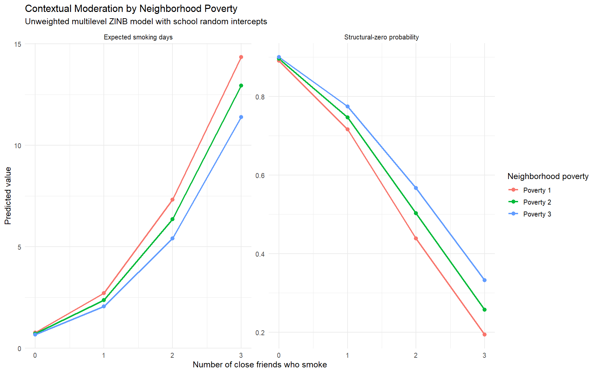
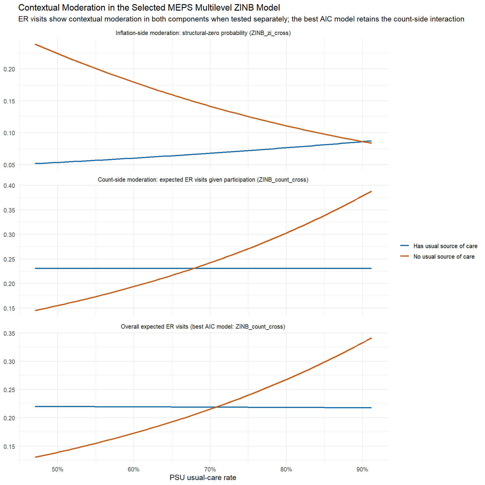
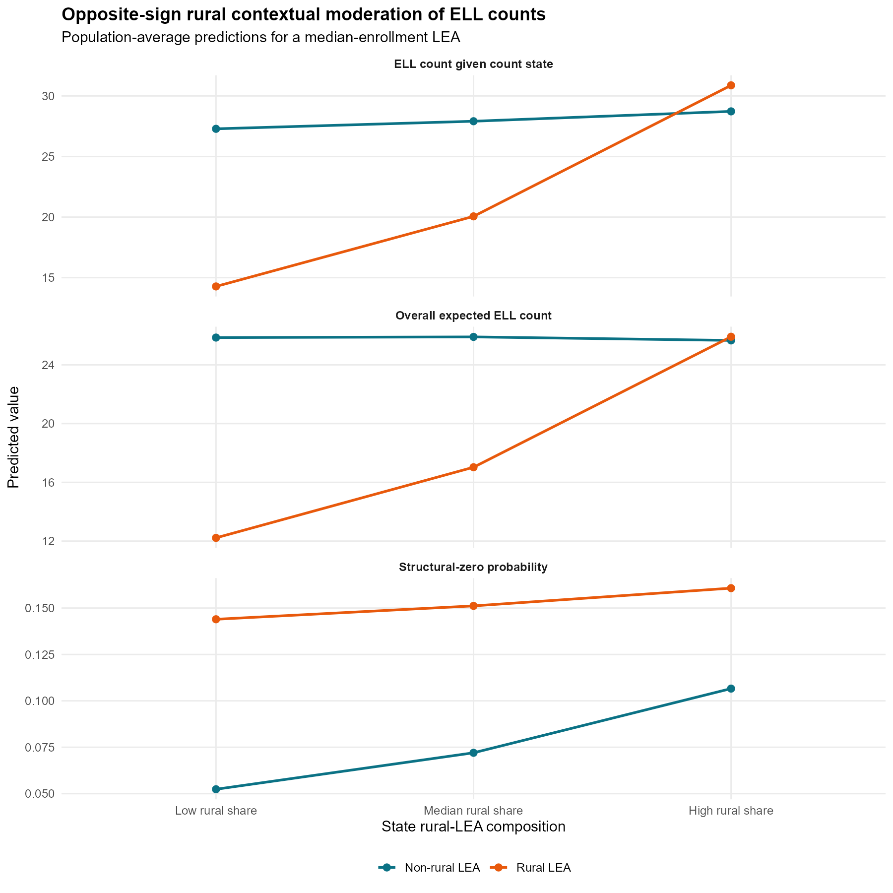

## Methods

### Analytic framework

For observation *i* in context *j*, the multilevel zero-inflated negative-binomial (ML-ZINB) model represented membership in the structural-zero class with a logit link and expected count intensity in the negative-binomial state with a log link. The focal lower-level predictor, contextual variable, and their cross-level interaction could enter either component. A positive inflation coefficient indicates higher log odds of the structural-zero state, whereas a positive count coefficient indicates higher expected count intensity conditional on the count-generating state. Consequently, coefficient signs must be interpreted relative to the event represented by each component.

Across applications, candidate specifications included negative binomial models without zero inflation; ZINB with fixed or randomly varying inflation; additive contextual predictors; contextual moderation in the count component only; contextual moderation in the inflation component only; and contextual moderation in both components. Models were evaluated using convergence status, positive-definite-Hessian diagnostics, AIC, nested likelihood-ratio tests, component-specific coefficients, and marginal predictions.

### Add Health application

The Add Health analysis used Wave I public-use data and was estimated without sampling weights. Cigarette-smoking days during the previous 30 days (`H1TO5`) were modeled as the outcome. Number of close friends who smoked (`H1TO9`) was the individual predictor, and neighborhood poverty (`BST90P19`) was the contextual moderator. Covariates were home cigarette availability, interviewer-observed smoking cues, sex, age, urbanicity, neighborhood median household income, and constituent main effects. Continuous predictors were standardized. Adolescents were nested in `CLUSTER2` school clusters, with a random intercept in the count component.

### MEPS application

The MEPS analysis used the 2023 Full Year Consolidated File, restricted to adults with positive person weights, while estimating unweighted multilevel models. Respondents were nested in public-file variance-estimation PSUs defined by `VARSTR` and `VARPSU`. Emergency-room visits (`ERTOT23`) were the outcome. No usual source of care (`HAVEUS42`) was the individual predictor, and the PSU proportion reporting a usual source of care was the moderator. Covariates included all-year uninsurance, age, sex, low income, poor or fair self-rated health, Census region, and constituent main effects. Because these models did not implement the full MEPS survey design, they are model-based multilevel estimates rather than official nationally representative estimates.

### CCD LEA application

The final third empirical application used the 2009-10 Common Core of Data Local Education Agency Universe Survey. The analysis retained operating regular districts, districts that were components of supervisory unions, and charter agencies in the 50 states with positive membership and at least one school. English learner (`ELL09`) enrollment was the primary count outcome. Negative NCES codes denoting missing, not applicable, or suppressed data were treated as missing.

Rural LEA status was the lower-level predictor and the state proportion of rural LEAs was the contextual moderator. The contextual proportion for each LEA excluded the focal LEA and was standardized. Models included the logarithm of total membership as an offset and adjusted for standardized log enrollment, standardized log number of schools, city locale, charter status, enrollment below 500 students, one-school status, and constituent main effects. State random intercepts entered both the count and inflation components.

An initial screen crossed English learner and special-education counts with rural, city, charter, small-enrollment, and one-school characteristics and their matched state compositions under fixed- and random-inflation specifications. Stable opposite-sign candidates required convergence, a positive-definite Hessian, opposite interaction signs, and p < .05 in both components. Benjamini-Hochberg adjusted p values were calculated. The selected rurality candidate was then evaluated using additive, count-interaction, inflation-interaction, and joint-interaction models. Nested likelihood-ratio tests determined whether each interaction improved the model containing the other interaction.

### Hurdle sensitivity analyses

For Add Health and MEPS, mixed-effects logistic models examined any observed use, and zero-truncated negative-binomial mixed models examined positive-count intensity. These analyses assessed observed participation and intensity but were not interpreted as direct estimates of latent structural-zero membership.

### Comprehensive simulation study

The simulation generated clustered NB or ZINB outcomes from a standardized lower-level predictor, standardized contextual variable, binary covariate, and random intercepts in the count and inflation processes. Seven truth cases were included: null moderation, additive contextual effects without interactions, NB truth, inflation-only moderation, count-only moderation, dual same-sign moderation, and dual opposite-sign moderation. Active interaction magnitudes were 0.15 and 0.30. Designs contained either 40 clusters of 30 observations or 80 clusters of 60 observations, yielding 22 conditions.

Seven fitted models were compared: NB, fixed-inflation ZINB, random-inflation-only ZINB without measured contextual predictors, additive ZINB, count-interaction ZINB, inflation-interaction ZINB, and joint-interaction ZINB. Evaluation measures included convergence, AIC selection, structural-zero prediction mean-squared error, unconditional-mean prediction error, interaction bias and RMSE, empirical and model-based standard errors, 95% coverage, rejection rates, and Monte Carlo standard errors.

The retained execution run used four replications per condition and verifies the full 22-condition, seven-model workflow. Its numerical selection, coverage, type I error, and power values are retained as computational pilot outputs; publication-level Monte Carlo estimates require the prespecified larger replication run.

## Results

### Add Health

The analytic sample comprised 5,235 adolescents in 132 clusters, and 70.5% reported zero smoking days. The inflation-interaction model had the lowest AIC (16,163.70). Adding the peer-smoking by neighborhood-poverty interaction to the inflation component improved fit relative to additive ZINB, LR chi-square(1) = 5.09, p = .024. The interaction was positive, *b* = 0.091, SE = 0.040, p = .023. The count interaction was unsupported, *b* = 0.019, SE = 0.026, p = .466, and did not improve fit, LR chi-square(1) = 0.53, p = .466. Adding the count interaction to the inflation-interaction model was also unsupported, p = .330.

The hurdle sensitivity localized the result to observed participation. The interaction predicted lower odds of any smoking, *b* = -0.081, SE = 0.037, p = .029, but not smoking frequency among adolescents with positive counts, *b* = 0.023, SE = 0.026, p = .360. The reversed sign in the any-smoking model is consistent with the opposite event orientation of structural-zero membership.

{width=82%}

### MEPS

The sample contained 14,144 adults nested in 262 PSUs. ER visits were zero for 84.0% of respondents and averaged 0.24. Additive ZINB improved on NB, LR chi-square(10) = 50.52, p < .001. Relative to additive ZINB, adding the interaction separately improved the inflation model, LR chi-square(1) = 8.77, p = .003, and the count model, LR chi-square(1) = 23.96, p < .001. The standalone inflation interaction was negative, *b* = -0.535, SE = 0.202, p = .008, whereas the count interaction was positive, *b* = 0.292, SE = 0.061, p < .001.

The count-interaction model had the lowest AIC (15,813.52). Adding the inflation interaction to that model did not improve fit, LR chi-square(1) = 0.12, p = .730. MEPS therefore provides supported count-side moderation and opposite-signed standalone inflation sensitivity, but not evidence that both interactions are required simultaneously in the preferred model. Hurdle analyses supported effects on any ER use, *b* = 0.155, SE = 0.058, p = .007, and positive-count intensity, *b* = 0.490, SE = 0.131, p < .001.

{width=84%}

### CCD LEA

The analytic sample contained 15,611 LEAs in 50 states; valid ELL counts were available for 15,610. ELL enrollment was zero in 36.35% of LEAs, with a mean of 300.3 and variance of 5,644,323. Half of eligible LEAs were rural, and the median state rural-LEA share was 55.5%.

The baseline NB AIC was 123,406.0, and fixed-inflation ZINB AIC was 123,408.0. Allowing a state random intercept in the inflation component reduced AIC to 122,032.4, with an inflation random-effect SD of 3.14. This substantial improvement established random state inflation as the appropriate baseline for the ELL analysis.

Seventeen of 20 screened models converged with positive-definite Hessians, and three met nominal and BH-adjusted opposite-sign criteria. The strongest was rural LEA status by state rural-LEA composition. In the joint random-inflation model, the count interaction was positive, *b* = 0.277, SE = 0.035, p < .001, BH p < .001, whereas the inflation interaction was negative, *b* = -0.247, SE = 0.071, p < .001, BH p = .002.

The joint model had the lowest AIC (119,146.6), followed by count-interaction (119,156.2), inflation-interaction (119,206.5), and additive models (119,224.3). Adding inflation moderation to the count-interaction model improved fit, LR chi-square(1) = 11.55, p < .001, and adding count moderation to the inflation-interaction model improved fit, LR chi-square(1) = 61.86, p < .001. Both component interactions therefore contributed independently.

The count interaction corresponds to a rate ratio of exp(0.277) = 1.32 per one-SD increase in state rural composition for the rural versus non-rural contrast. The inflation interaction corresponds to a structural-zero odds ratio of exp(-0.247) = 0.78. For a median-enrollment rural LEA, the predicted ELL count conditional on the count state increased from 14.3 at low state rural composition to 30.9 at high rural composition; non-rural estimates were 27.3 and 28.7. The modeled rural/non-rural structural-zero probability difference narrowed as state rural composition increased.

{width=84%}

### Comprehensive simulation

The complete simulation workflow executed all 22 conditions and seven candidate models and generated the planned model-selection, parameter-recovery, inflation-omission, prediction-error, coverage, rejection-rate, and Monte Carlo-error outputs. The retained pilot demonstrates that the design handles no inflation, fixed inflation, unexplained random inflation, additive context, component-specific moderation, same-sign dual moderation, and opposite-sign dual moderation within a common evaluation framework.

The simulation design directly aligns with the empirical cases. Inflation-only truth represents the Add Health pattern; count-only or count-dominant truth represents the preferred MEPS result; and dual opposite-sign truth represents the selected CCD LEA model. The null, additive-only, NB, and same-sign dual cases prevent the evaluation from assuming that contextual moderation or zero inflation is always present.

### Integrated interpretation

The empirical analyses demonstrate that contextual moderation can occupy different parts of a zero-inflated model. Add Health showed inflation-dominant moderation, for which placing the interaction only in the count component would miss the supported mechanism. MEPS showed count-dominant moderation with opposite-signed inflation sensitivity when examined separately, demonstrating that the inflation process can alter interpretation even when the preferred model retains only count moderation. CCD LEA provided the final joint opposite-sign case: both interactions were stable, multiplicity-adjusted, and independently improved model fit.

Together, these findings support a component-aware analytic strategy. Investigators should compare NB, fixed-inflation, random-inflation, additive, count-interaction, inflation-interaction, and joint-interaction specifications; verify convergence and Hessian diagnostics; use nested tests and information criteria; and translate component coefficients into marginal structural-zero probabilities and expected counts. Treating inflation as fixed or omitting measured contextual moderation can conceal substantively different processes and produce an incomplete account of contextual heterogeneity.

## Limitations

The Add Health and MEPS multilevel models are unweighted demonstrations and should not be interpreted as official nationally representative estimates. The CCD analysis uses a single cross-sectional administrative census and same-year state composition, so temporal ordering is not established and interpretation should remain associational. Zero ELL enrollment may reflect local population composition, district organization, program assignment, or reporting practice rather than a substantively verified permanent-exclusion state. Finally, the retained comprehensive simulation output is an execution pilot; final Monte Carlo rates require the prespecified larger replication run.
