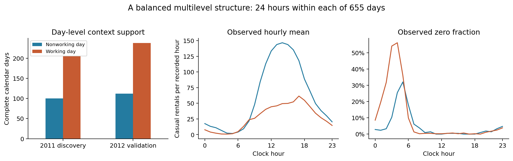
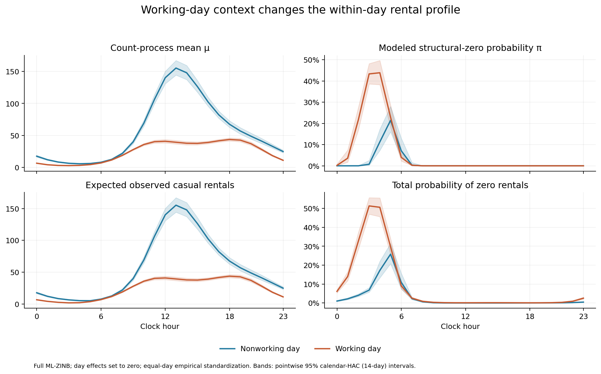
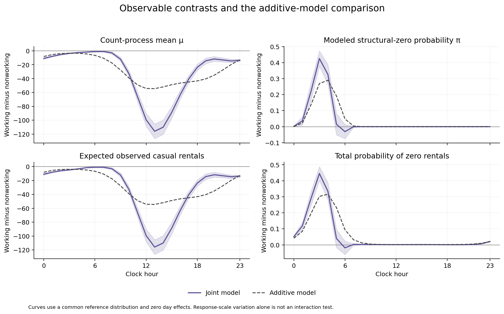
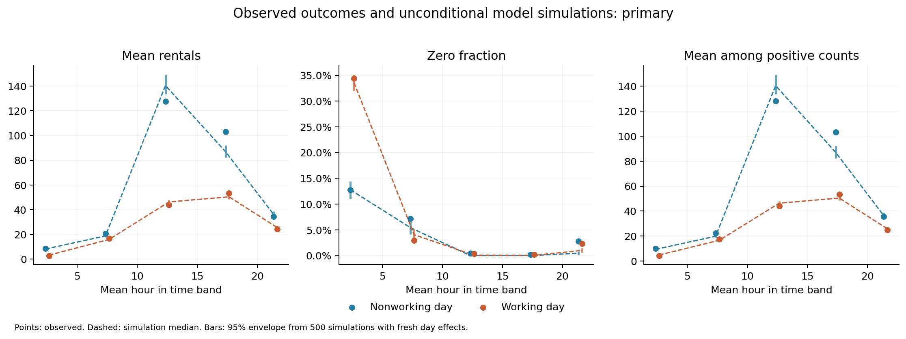
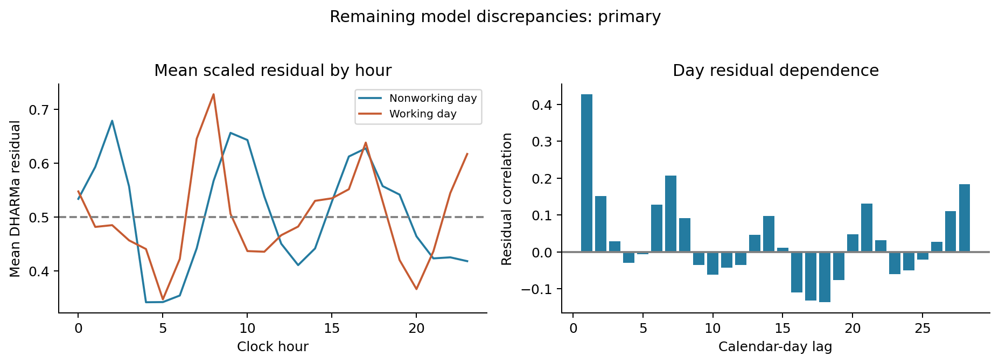
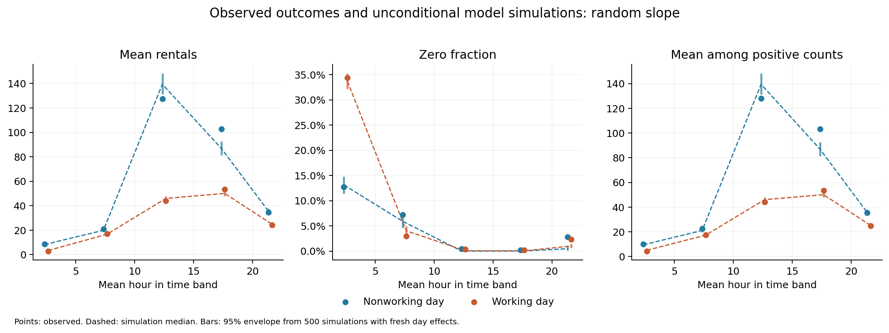
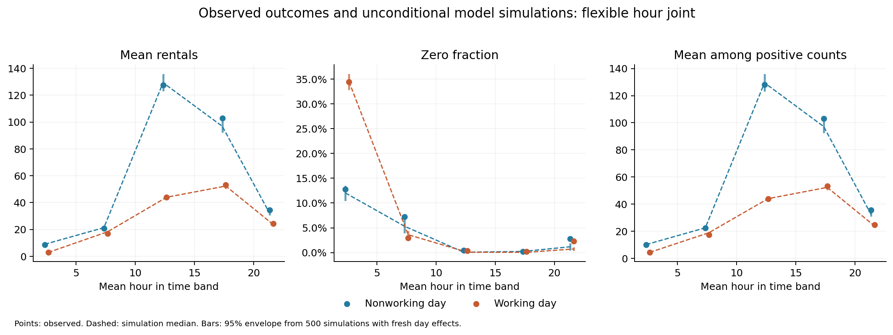
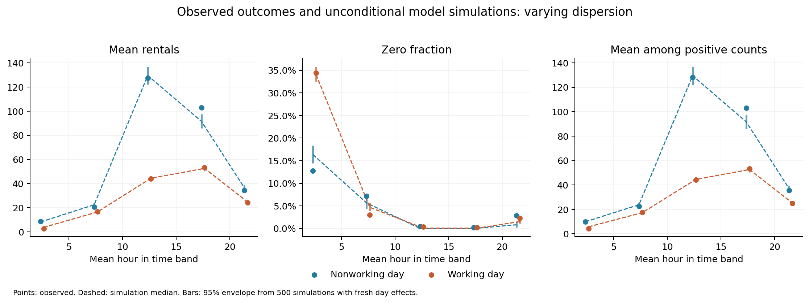
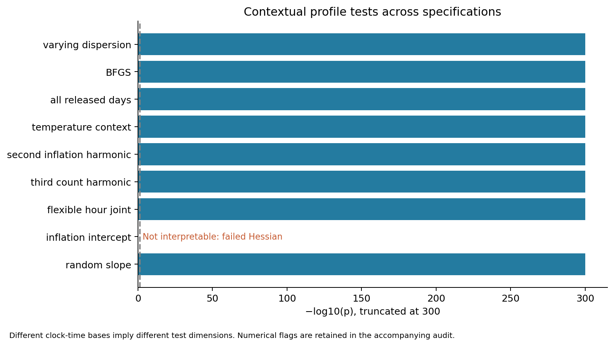
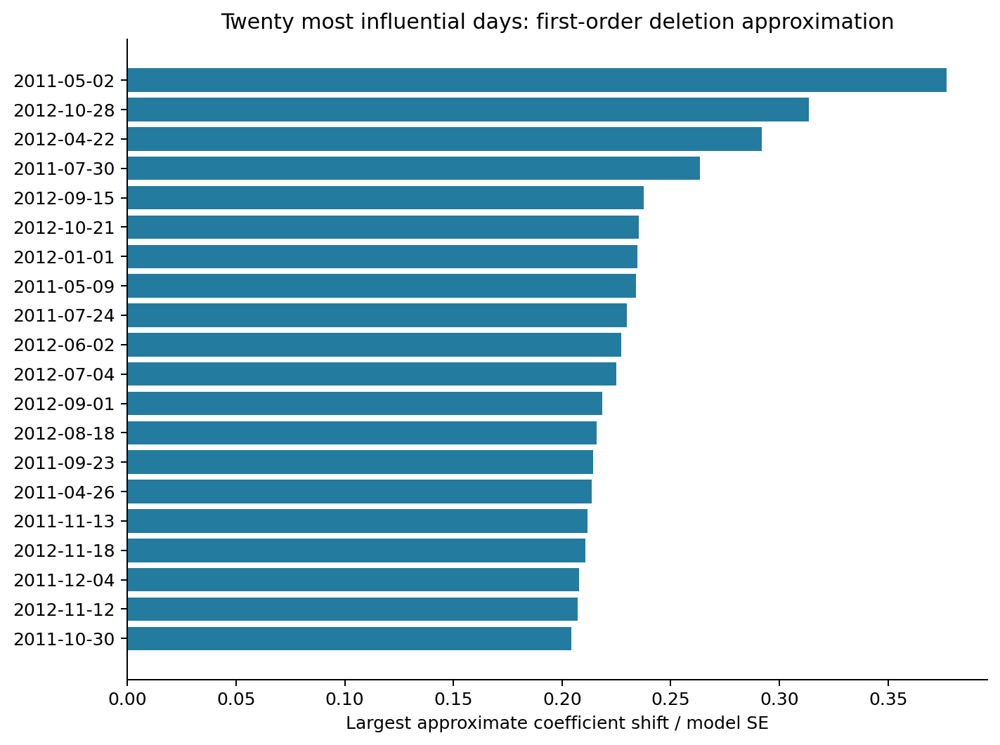

# Social-science walkthrough: contextual moderation in ML-ZINB

**Capital Bikeshare provides a supported example of contextual moderation:** the within-day clock-time profile of casual rental counts differs between working and nonworking days. The frozen revised model supports this in **2011 discovery** and **2012 temporal validation**, including calendar-time robust uncertainty. Distributional fit remains imperfect, especially in the upper tail. These are associations in one transport system, not causal effects or independent-city replication.

UCI explicitly classifies this dataset as **Social Science**. The primary sample contains **15,720 recorded hours within 655 complete calendar days**, each with exactly 24 observations. **1,278 counts are zero (8.13%)**. The selected example follows a transparent search and a discovery-only model revision; all previous attempts remain available.

## 1. Dataset, hierarchy and question

**Question:** Does working-day context modify the daily time pattern of casual bike rentals?

The outcome is the released hourly count of casual-user rentals. These are rental events, not unique individuals. Level 1 is a recorded clock-hour slot; level 2 is the calendar day. Workingday is a day-level indicator defined by the source as neither weekend nor holiday. It is constant within each day and varies across days. Clock-time predictors vary within every primary day.

| sample | observations | days | zeros | mean | variance |
| --- | --- | --- | --- | --- | --- |
| discovery | 7320 | 305 | 590 | 31.780 | 1644.787 |
| validation | 8400 | 350 | 688 | 43.649 | 3308.540 |

Discovery has 305 complete days (100 nonworking and 205 working); validation has 350 (112 nonworking and 238 working). The raw download contains 17,379 hourly records across 731 days. It has 165 fewer records than a nominal 24-hours-per-day grid. The 76 incomplete days are retained in an all-records sensitivity; absent hours are not silently turned into zeros. Hourly sums reconcile exactly to the companion daily file for casual, registered and total rentals.

The first two sine/cosine harmonics represent the count-component time profile; the first harmonic represents inflation. These functions have exactly zero mean within a complete 24-record day, giving a clean within-day predictor. A separate between-day mean is mathematically constant and cannot be estimated. This is a **day-level context**, not a neighborhood or institutional context. It is suitable when the paper allows repeated occasions within contextual units.

## 2. Search record and validation boundary

| Attempt | Primary finding | Decision |
| --- | --- | --- |
| German health-care panel: within-person dissatisfaction × recorded sex | Joint LR p = .07066 in discovery | Rejected as the requested supported example; its validation people were not modeled |
| Bikeshare: midday-window × workingday | Strong count evidence, but inflation interaction SE approximately 10,000 | Rejected as a regular four-model demonstration; original fits retained |
| Bikeshare: smooth daily profile × workingday, complete-day sample | Supported in discovery and temporal validation | Selected, with component and adequacy qualifications below |

The shorter COUNT::rwm extract omitted person identifiers. The full health archive was obtained and its original authors' corrections were applied before the discovery fits: 1987 disability coding was reversed, and known mean-imputed health/education/disability rows were excluded. This failed candidate is retained rather than hidden. A county-murder panel was downloaded and documented but no moderation model was fitted. Other documentation-only candidates are listed in the search protocol.

The midday analysis was revised because its inflation product concerned a region where modeled extra zeros were essentially absent. The first 2012 additive fit had been started and was stopped; **no 2012 interaction result was inspected before the daily-profile amendment**. Source-level descriptive cell summaries, including 2012 counts, had been inspected during the data audit. The final daily-profile equations and sample rule were frozen before fitting its 2012 interaction models. This is exploratory model development with a temporal check, not a preregistered study.

A simple three-attempt Bonferroni threshold is .0167; the selected primary and calendar-HAC joint tests remain far below it. This transparency calculation does not account for every possible analytic choice; the temporal validation provides the more useful check. The complete [revised protocol](bikeshare_profile/protocol.md) and [initial search protocol](search_protocol.md) are retained.

## 3. Four matched ML-ZINBs and numerical checks

All four NB2 models use identical observations and controls within each sample. The count equation includes a day random intercept, the four clock-time basis terms, workingday, month indicators, temperature and its square, humidity, wind speed and bad weather. The smaller inflation equation includes two clock-time terms, workingday, temperature, humidity and bad weather. Weather codes 3/4 are pooled because code 4 has only three source records. Released normalized weather units are retained because archived descriptions disagree about temperature transformations. Full-sample equations also include a 2012 indicator; separate-year equations cannot estimate it.

| Model | Count contextual products | Inflation contextual products |
| --- | --- | --- |
| Additive | None | None |
| Count only | 4 clock-time × workingday products | None |
| Inflation only | None | 2 clock-time × workingday products |
| Joint | 4 products | 2 products |

The primary additive-to-joint test has **6 df**, count additions have **4 df**, and inflation additions have **2 df**. This vector-predictor example should not be described as a scalar two-df joint test. No arbitrary inflation coefficient was fixed. The raw estimates, SEs, gradients and Hessian flags are saved for every fit. Inflation coefficients can be large because the transition to nighttime zeros is sharp; their joint functions and uncertainty are more meaningful than an isolated harmonic coefficient.

| model | logLik | AIC | df | convergence | pdHess | max_abs_gradient |
| --- | --- | --- | --- | --- | --- | --- |
| additive | -57061.740 | 114189.479 | 33 | 0 | True | 0.089 |
| count | -55844.487 | 111762.974 | 37 | 0 | True | 0.045 |
| inflation | -56984.511 | 114039.022 | 35 | 0 | True | 0.093 |
| joint | -55792.427 | 111662.854 | 39 | 0 | True | 0.016 |
| nb | -56387.566 | 112833.132 | 29 | 0 | True | 0.150 |

The same-count-specification NB2 comparator has AIC **112833.13**, versus **111662.85** for the joint ML-ZINB. This supports a useful mixture in this working specification. It does not verify a genuine structural non-rental class. No ordinary chi-square NB-versus-ZINB boundary test is claimed. The alternate BFGS joint fit changes log likelihood by **4.61005e-08**; its full numerical audit is retained.

## 4. Moderation evidence and component location

| sample | LR | df | p |
| --- | --- | --- | --- |
| discovery | 1349.297 | 6 | 2.30e-288 |
| validation | 1290.666 | 6 | 1.14e-275 |
| full | 2538.625 | 6 | <1e-300 |

The conditional additions, which hold the other component's contextual products present, give:

| sample | comparison | LR | df | p |
| --- | --- | --- | --- | --- |
| discovery | count -> joint | 43.416 | 2 | 3.74e-10 |
| discovery | inflation -> joint | 1285.534 | 4 | 4.56e-277 |
| validation | count -> joint | 55.155 | 2 | 1.05e-12 |
| validation | inflation -> joint | 1213.108 | 4 | 2.29e-261 |
| full | count -> joint | 104.120 | 2 | 2.46e-23 |
| full | inflation -> joint | 2384.168 | 4 | <1e-300 |

Because hours within a day are dependent and adjacent days may also be dependent, the workflow reconstructs **day marginal-likelihood scores including fixed effects, dispersion and random-intercept SD**. Their likelihood sum matches glmmTMB within 4.22e-10; summed scores match the package gradient within 1.94e-05. Sandwich covariance uses G/(G−1). Calendar-HAC additionally uses 14-day Bartlett lags; excluded dates retain their calendar positions. These checks make the group-aware uncertainty independently reviewable.

| sample | component | Wald | df | p |
| --- | --- | --- | --- | --- |
| discovery | joint | 790.219 | 6 | 2.00e-167 |
| discovery | count | 713.906 | 4 | 3.40e-153 |
| discovery | inflation | 28.498 | 2 | 6.48e-07 |
| validation | joint | 567.151 | 6 | 2.83e-119 |
| validation | count | 440.440 | 4 | 5.06e-94 |
| validation | inflation | 26.190 | 2 | 2.06e-06 |
| full | joint | 1076.459 | 6 | 2.58e-229 |
| full | count | 945.816 | 4 | 1.97e-203 |
| full | inflation | 53.260 | 2 | 2.72e-12 |

The 2012 validation retains a highly supported count-profile interaction and a supported inflation-profile interaction under the frozen primary equation. Lag-7 and lag-28 results are also retained. The claim concerns entire clock-time profiles; individual sine/cosine coefficients are basis parameters, not standalone morning or evening effects.

## 5. Component-aware visual walkthrough

For each reference record, compute the count-process mean μ, modeled structural-zero probability π, overall expectation (1−π)μ, and total zero probability π+(1−π)[φ/(φ+μ)]^φ. Average each record-level quantity only after forming the mixture. μ is not the observed mean among positive rentals.

Both day types are standardized over the same equal-day empirical distribution of calendar and weather covariates. Day random effects are fixed at zero. Thus these are common-reference model associations, not predictions integrated over the random-effect distribution or causal counterfactuals. Clock hour and all of its basis functions are updated together. Bands are pointwise 95% calendar-HAC intervals, conditional on the observed reference covariates.

| hour | context | metric | value | lower | upper |
| --- | --- | --- | --- | --- | --- |
| 3 | Nonworking | expected | 6.468 | 5.888 | 7.105 |
| 3 | Nonworking | total_zero | 0.068 | 0.057 | 0.081 |
| 8 | Nonworking | expected | 21.965 | 20.242 | 23.836 |
| 8 | Nonworking | total_zero | 0.006 | 0.005 | 0.009 |
| 13 | Nonworking | expected | 155.307 | 144.325 | 167.125 |
| 13 | Nonworking | total_zero | 7.18e-06 | 2.36e-06 | 2.19e-05 |
| 18 | Nonworking | expected | 67.455 | 62.511 | 72.791 |
| 18 | Nonworking | total_zero | 2.34e-04 | 1.16e-04 | 4.73e-04 |
| 22 | Nonworking | expected | 33.018 | 30.140 | 36.171 |
| 22 | Nonworking | total_zero | 0.002 | 0.001 | 0.004 |
| 3 | Working | expected | 1.787 | 1.534 | 2.081 |
| 3 | Working | total_zero | 0.513 | 0.469 | 0.557 |
| 8 | Working | expected | 18.950 | 17.962 | 19.992 |
| 8 | Working | total_zero | 0.009 | 0.007 | 0.012 |
| 13 | Working | expected | 39.374 | 36.707 | 42.234 |
| 13 | Working | total_zero | 0.001 | 7.78e-04 | 0.002 |
| 18 | Working | expected | 43.697 | 41.392 | 46.131 |
| 18 | Working | total_zero | 9.89e-04 | 5.75e-04 | 0.002 |
| 22 | Working | expected | 18.471 | 17.307 | 19.714 |
| 22 | Working | total_zero | 0.009 | 0.007 | 0.012 |

The profiles distinguish a change in the intensity of the count process from a change in the modeled extra-zero process. Total zeros also include negative-binomial zeros. A latent π curve must not be read as a measured proportion of people who never cycle.

The additive model also produces clock-dependent differences on the response scale because its links are nonlinear. Here, the joint product tests independently establish link-scale moderation. The plots then show its magnitude and how the components combine. A descriptive summary comparing the average of hours 10–15 with the average of the other 18 hours is saved below; this window summary is not the primary harmonic-product test.

| metric | difference_in_contrasts | se | lower | upper |
| --- | --- | --- | --- | --- |
| mu | -72.064 | 3.475 | -78.875 | -65.253 |
| pi | -0.055 | 0.005 | -0.065 | -0.045 |
| expected | -71.954 | 3.474 | -78.763 | -65.146 |
| total_zero | -0.071 | 0.004 | -0.079 | -0.062 |

## 6. Model adequacy

Each diagnostic uses 500 unconditional simulations with fresh day effects and fixed fitted parameters. Individual residual tests are sensitive to small discrepancies with 15,720 records. Assess the magnitude and hour/day-type pattern alongside p-values.

| test | statistic | p |
| --- | --- | --- |
| uniformity | 0.023 | 1.80e-07 |
| dispersion | 0.511 | <.004 (500 simulations) |
| zero_inflation | 1.066 | 0.008 |
| day_aggregated_uniformity | 0.056 | 0.035 |

| statistic | observed | simulation_median | lower | upper |
| --- | --- | --- | --- | --- |
| mean | 38.122 | 38.421 | 37.240 | 39.648 |
| variance | 2568.714 | 3431.289 | 3085.225 | 3926.933 |
| zero_fraction | 0.081 | 0.076 | 0.073 | 0.080 |
| positive_mean | 41.496 | 41.594 | 40.332 | 42.951 |
| max | 367.000 | 907.000 | 693.850 | 1390.675 |
| all_zero_days | 0 | 0 | 0 | 0 |

The independent random-slope model was also checked with 500 unconditional simulations:

| test | statistic | p |
| --- | --- | --- |
| uniformity | 0.019 | 2.97e-05 |
| dispersion | 0.496 | <.004 (500 simulations) |
| zero_inflation | 1.056 | 0.024 |
| day_aggregated_uniformity | 0.056 | 0.033 |

**Full hour-factor count model**

| test | statistic | p |
| --- | --- | --- |
| uniformity | 0.021 | 2.64e-06 |
| dispersion | 0.546 | <.004 (500 simulations) |
| zero_inflation | 1.057 | 0.016 |
| day_aggregated_uniformity | 0.064 | 0.010 |

| statistic | observed | simulation_median | lower | upper |
| --- | --- | --- | --- | --- |
| mean | 38.122 | 37.890 | 36.821 | 39.022 |
| variance | 2568.714 | 2990.816 | 2708.131 | 3338.807 |
| zero_fraction | 0.081 | 0.077 | 0.073 | 0.081 |
| positive_mean | 41.496 | 41.023 | 39.904 | 42.240 |
| max | 367.000 | 748.000 | 568.900 | 1115.525 |
| all_zero_days | 0 | 0 | 0 | 0 |

**Clock-time and context-varying dispersion**

| test | statistic | p |
| --- | --- | --- |
| uniformity | 0.036 | 4.01e-18 |
| dispersion | 0.593 | <.004 (500 simulations) |
| zero_inflation | 0.996 | 0.884 |
| day_aggregated_uniformity | 0.092 | 3.14e-05 |

| statistic | observed | simulation_median | lower | upper |
| --- | --- | --- | --- | --- |
| mean | 38.122 | 38.077 | 36.707 | 39.441 |
| variance | 2568.714 | 2893.960 | 2542.998 | 3336.468 |
| zero_fraction | 0.081 | 0.082 | 0.078 | 0.086 |
| positive_mean | 41.496 | 41.463 | 39.999 | 42.955 |
| max | 367.000 | 680.000 | 529.475 | 1036.150 |
| all_zero_days | 0 | 0 | 0 | 0 |

The primary model simulates a median maximum of about 907 rentals against the observed 367, with a lower 95% envelope around 694. This is a material upper-tail discrepancy. Flexible hour effects improve it, and time/context-varying dispersion calibrates the zero fraction much better (zero test p=.884), but neither removes the upper-tail issue. The dispersion sensitivity was added in response to this diagnostic failure, as documented in [the adequacy amendment](bikeshare_profile/adequacy_amendment.md). Its estimates are secondary, not a newly independent validation result.

Remaining discrepancies constrain claims about distributional adequacy and latent components. A supported and repeatedly observed clock-time interaction does not certify every part of the ZINB mechanism. The zero probabilities and extreme-count predictions should not be presented as fully validated probabilities. Monte Carlo diagnostic p-values reported as zero are shown at the simulation resolution rather than as impossibly precise analytic p-values.

## 7. Robustness and influential days

The variants address within-day heterogeneity, the inflation random structure, flexible clock-time shapes, weather-by-context differences, incomplete-day coverage, and optimization. Each test includes all contextual clock-time products of that model. The full hour-factor model tests 23 count products plus 2 inflation products; changing test dimensions are shown rather than comparing one selected harmonic.

| model | rows | AIC | convergence | pdHess | gradient | max_coef | max_se | df | p |
| --- | --- | --- | --- | --- | --- | --- | --- | --- | --- |
| random_slope | 15720 | 110042.176 | 0 | True | 0.048 | 27.798 | 5.670 | 6.000 | <1e-300 |
| inflation_intercept | 15720 | NA | 0 | False | 0.045 | 31.087 | NA | 6.000 | NA |
| flexible_hour_additive | 15720 | 111881.578 | 0 | True | 0.022 | 35.010 | 566.946 | NA | NA |
| flexible_hour_joint | 15720 | 108421.285 | 0 | True | 0.014 | 7.607 | 1.423 | 25.000 | <1e-300 |
| third_count_harmonic | 15720 | 109516.993 | 0 | True | 0.061 | 36.809 | 8.937 | 8.000 | <1e-300 |
| second_inflation_harmonic | 15720 | 111646.013 | 0 | True | 0.013 | 20.053 | 10.758 | 8.000 | <1e-300 |
| temperature_context | 15720 | 111639.591 | 0 | True | 0.098 | 30.443 | 6.261 | 6.000 | <1e-300 |
| all_released_days | 17379 | 120611.225 | 0 | True | 0.070 | 28.150 | 6.026 | 6.000 | <1e-300 |
| BFGS | 15720 | 111662.854 | 0 | True | 0.020 | 31.087 | 6.218 | 6.000 | <1e-300 |
| varying_dispersion | 15720 | 109898.898 | 0 | True | 0.070 | 40.554 | 11.965 | 6.000 | <1e-300 |

AIC is comparable only for models fitted to the same observations. The all-released-days variant has 17,379 rows and its AIC must not be compared directly with complete-day AIC values. These sensitivity tests use model-based covariance; the independently verified day-cluster/calendar-HAC inference belongs to the primary model.

The component tests for valid variants are:

| model | component | df | p |
| --- | --- | --- | --- |
| random_slope | count | 4 | <1e-300 |
| random_slope | inflation | 2 | 1.56e-13 |
| flexible_hour_joint | count | 23 | <1e-300 |
| flexible_hour_joint | inflation | 2 | 4.59e-10 |
| third_count_harmonic | count | 6 | <1e-300 |
| third_count_harmonic | inflation | 2 | 2.60e-06 |
| second_inflation_harmonic | count | 4 | <1e-300 |
| second_inflation_harmonic | inflation | 4 | 2.18e-14 |
| temperature_context | count | 4 | <1e-300 |
| temperature_context | inflation | 2 | 4.00e-11 |
| all_released_days | count | 4 | <1e-300 |
| all_released_days | inflation | 2 | 7.37e-13 |
| BFGS | count | 4 | <1e-300 |
| BFGS | inflation | 2 | 3.16e-11 |
| varying_dispersion | count | 4 | <1e-300 |
| varying_dispersion | inflation | 2 | 5.95e-06 |

Do not treat a significant joint test as proof that both components are robust in every specification. Inflation conclusions deserve particular attention when its equation or random structure changes. The corresponding raw model summaries and audit record all numerical flags, including any very large SEs.

The extra inflation random intercept has SD about 0.000032 and a non-positive-definite Hessian; its Wald p-value is not interpretable and is excluded from inference. The hour-factor additive comparator also has a weak inflation nuisance direction (maximum SE about 567). Its conventional LR reference is therefore not used as confirmation. The hour-factor joint model has much smaller finite SEs and provides a useful separate Wald sensitivity for the full contextual time profile.

First-order deletion influence was evaluated for all 655 days. The five largest approximate influences and five fixed evenly spaced dates were then reoptimized exactly (10 distinct deletions). This is not a claim of 655 exact deletion refits. The verified day sandwich and calendar-HAC provide the group-aware uncertainty; no full refit cluster bootstrap is claimed for this application.

The largest selected exact shift is 0.380 model SEs. Across the 60 selected coefficient shifts, the maximum approximation error is 0.016 model SEs and the correlation of standardized approximate/exact shifts is 0.999. No selected deletion removes the joint moderation evidence.

| date | selection | convergence | pdHess | max_shift_model_SE | df | p |
| --- | --- | --- | --- | --- | --- | --- |
| 2011-05-02 | top approximate influence | 0 | True | 0.380 | 6 | 0 |
| 2012-10-28 | top approximate influence | 0 | True | 0.317 | 6 | 0 |
| 2012-04-22 | top approximate influence | 0 | True | 0.294 | 6 | 0 |
| 2011-07-30 | top approximate influence | 0 | True | 0.266 | 6 | 0 |
| 2012-09-15 | top approximate influence | 0 | True | 0.239 | 6 | 0 |
| 2011-01-01 | fixed calendar position | 0 | True | 0.120 | 6 | 0 |
| 2011-08-02 | fixed calendar position | 0 | True | 0.038 | 6 | 0 |
| 2012-01-26 | fixed calendar position | 0 | True | 0.100 | 6 | 0 |
| 2012-07-15 | fixed calendar position | 0 | True | 0.192 | 6 | 0 |
| 2012-12-31 | fixed calendar position | 0 | True | 0.099 | 6 | 0 |

## 8. Recommendation for the methodological study

Use this as a **positive social-science walkthrough of contextual moderation in within-day activity profiles**, with the temporal validation and model-development history visible. It has a clean, balanced observed hierarchy, a genuine day-level moderator, an appropriate count response with observed zeros, and a supported interaction that can be assessed separately in the two mixture components.

The practical sequence is: audit grouping and coverage; freeze a substantive question; fit the four matched models; inspect component identification; test the contextual products jointly and conditionally; draw all four model quantities and an additive overlay; check adequacy; then assess group/time-aware uncertainty, richer random structures and influence. This example also shows why a numerically converged but unidentified inflation product should prompt model revision before validation.

A defensible conclusion is: **“The clock-time profile of casual bike rentals differs between working and nonworking days. This contextual association is reproduced in a subsequent year and persists under dependence-aware uncertainty. Component-aware analysis distinguishes the count-profile change from the modeled extra-zero change; conclusions about the latter remain conditional on the inflation specification and adequacy checks.”**

It does not demonstrate causal moderation, a verified structural-zero mechanism, or generalization to other cities. If the paper requires geographic contexts such as neighborhoods or schools, day-level context must be explicitly justified rather than silently substituted.

## 9. Sources, license and reproducibility

Source: [UCI Bike Sharing](https://archive.ics.uci.edu/dataset/275/bike+sharing+dataset), dataset DOI [10.24432/C5W894](https://doi.org/10.24432/C5W894), categorized by UCI as Social Science. Cite Fanaee-T and Gama (2013), *Event labeling combining ensemble detectors and background knowledge*, DOI [10.1007/s13748-013-0040-3](https://doi.org/10.1007/s13748-013-0040-3). UCI states a [CC BY 4.0](https://creativecommons.org/licenses/by/4.0/) license; its page and original archive are retained. The source is Capital Bikeshare's 2011–2012 operational data, augmented with calendar/weather information.

The original health archive and author corrections are at [the Journal of Applied Econometrics data archive](http://qed.econ.queensu.ca/jae/2003-v18.4/riphahn-wambach-million/). Its use is restricted to scientific studies. No external messages or submissions were sent. Download timestamps, URLs and SHA-256 hashes are retained in [the manifest](download_manifest.json).

Limitations include one system, observational day types, changing system size and seasonality, unavailable inventory/rider exposure, missing clock-hour records, possible daylight-saving aggregation effects, temporal dependence beyond the chosen HAC lags, and mixture-model assumptions. The primary complete-day sample changes the population of days; the all-released-days sensitivity is therefore material.

See [README](README.md) for code, software versions, reproduction and artifact locations. Final integrity verification checks data, source hashes, matched tests, score reconstruction, predictions and files; it is not a claim of statistical model perfection.

Generated 2026-10-16 03:58 UTC.
